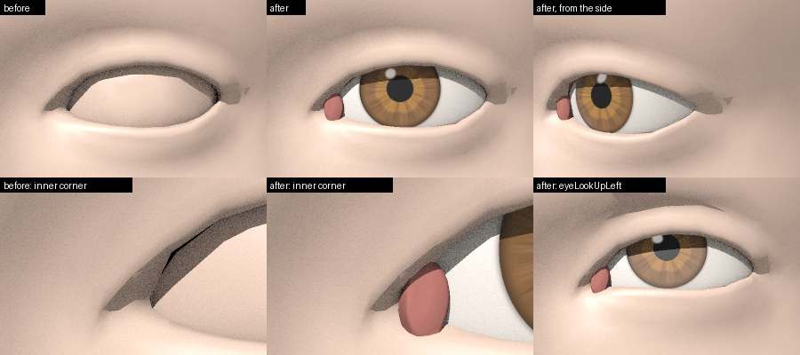

# Eyes

Anny's eyeballs are spheres of 72 vertices, and its skin goes on behind them into the eye socket. In an export they read as faceted balls without an iris, the cornea gives no highlight, and the socket's skin at the inner corner reads as a dark hole. A card whose `material` section holds `eyes` (`opensculptboy.eyes`) replaces them in the GLB and VRM exports with:

- a smooth eyeball, with the iris recessed a little behind the limbus;
- a separate, clear, refracting cornea over it (GLB files with procedural eyes); baked eyes take one surface with the corneal bulge under a clear coat, as the reference draws them;
- an eye texture of its own: a procedural iris, pupil, limbal ring and sclera, or the baked eyes of a fitted card;
- the caruncle, a low pink mound over the pocket in the inner corner, and the socket's skin drawn pink and wet;
- lashes along the upper and the lower lid margins: the reference's own for a fitted card, else generic lashes (see "Lashes").

A fitted card turns the eyes on without the section: a card whose bake measured the reference's eyes (`material.reference_eyes`) or baked its eye texture (`detail.textures.eyes`) takes the eyes' defaults, so that its exports show the reference's eyes with or without `--eyes`. `"eyes": false` in the card, or `--eyes off`, keeps anny's own eyeballs. Other cards without the section export exactly as before.

```bash
opensculptboy export character.glb --character character.json --eyes                 # the card's eyes, else the defaults
opensculptboy export character.glb --character character.json --eyes eyes.json       # eyes.json laid over them
opensculptboy export character.vrm --character character.json --eyes --author "Your name"
opensculptboy export character.glb --character fitted.json --eyes off            # anny's own eyeballs for a fitted card
blender --python src/opensculptboy/export/blender_skin.py -- character.glb           # the cornea's refraction in Cycles
```

```python
from opensculptboy import Character, export_glb

card = Character(material={"eyes": {"iris_color": [0.05, 0.12, 0.2], "pupil_mm": 3.5}})
export_glb("character.glb", card)
```



## The card

Every key of `material.eyes` is optional; colours are linear RGB and sizes millimetres. A `material` section that holds nothing but `eyes` keeps the exporters' own skin, so a card can change its eyes alone.

| Key | Default | Meaning |
|---|---|---|
| `source` | `"auto"` | `"auto"`: the baked eye texture when the file has one (the detail layer's `eyes`), else the procedural eye; `"procedural"`; `"baked"` (an error without a baked texture) |
| `base_color` | none | an eye texture of its own, in the layout below, as a path relative to the card |
| `iris_color` | `[0.20, 0.10, 0.04]` | the outer iris, a medium brown |
| `iris_color_inner` | a lighter amber of it | the zone inside the collarette |
| `iris_tint` | 0 | 0 to 1: how far a baked iris turns to `iris_color`, keeping its pattern |
| `iris_mm` | `"auto"` | the iris (limbus) diameter: millimetres, `"baked"` (the size found in the file's baked eye texture; an error without one) or `"auto"` (that size when the eyes come from a bake and an iris is found there, else 11.7) |
| `pupil_mm` | `"auto"` | the pupil diameter, likewise (3.5 when not baked: 3 to 4 mm in neutral light) |
| `limbal_ring`, `limbal_ring_mm` | 0.6, 0.6 | the darkening of the ring around the iris and its width |
| `sclera_color` | `[0.80, 0.74, 0.68]` | a slightly warm white |
| `veins` | 0.15 | 0 to 1: faint red veins at the periphery of the sclera |
| `seed` | 0 | the procedural pattern |
| `sclera_roughness` | 0.45 | the eyeball's own surface (under the clear coat of a single surface) |
| `cornea` | `"auto"` | GLB files: true, the refracting cornea shell over a recessed iris; false, one surface with a clear coat and the iris on its bulge, as the VRM files have; `"auto"`, false when the eye texture comes from a bake and true otherwise |
| `cornea_ior`, `cornea_roughness` | `"auto"` | the cornea (on a single surface, the IOR of the eyeball's own surface and the roughness of its clear coat): numbers, or `"auto"`, the values of the card's `reference_eyes` (below), else 1.376 and 0.02 |
| `cornea_radius_mm` | `"auto"` | the radius of curvature of the cornea's front, which sets the bulge's height and the size of the highlights: millimetres, or `"auto"`, the value of the card's `reference_eyes`, else 7.8 |
| `bulge` | 1 | the corneal bulge, a share of its anatomical height (the export lowers it further to clear the lids) |
| `caruncle` | true | the caruncle and the pink skin of the socket |
| `caruncle_color` | `[0.42, 0.15, 0.13]` | both of them |
| `highlight` | 1 | VRM files: the strength of the matcap highlight |
| `gaze` | `"auto"` | `"auto"`: each eye looks at rest where the reference's eye looks (the card's `reference_eyes.gaze`), else straight ahead; `"straight"`: along -Y |

A fitted card also records its reference's eyes in `material.reference_eyes`, which `opensculptboy fit --textures` and `opensculptboy bake` write when the reference has eye parts: the radius of curvature of the outer eye surface's front (`cornea_radius_mm`), its roughness and its IOR, and the direction in which each eye looks at rest (`gaze`, `{"L": [x, y, z], "R": [x, y, z]}` in Anny's frame). The eyes' `"auto"` values take them, and a number in `material.eyes` or in the file of `--eyes` overrides each one. The section turns the eyes on for a card without `material.eyes`.

The sizes are millimetres, because Anny's eyeball is larger than its lid opening suggests (about 32 mm across on the default character): an iris scaled with the eyeball would fill the whole opening.

## Geometry

`opensculptboy.eyes.geometry` builds the parts in each eye's frame (the least-squares sphere of the eyeball, the gaze along -Y, or along the card's `gaze`) as surfaces of revolution: the eyeball with the iris as a shallow dome behind the limbus; the cornea, a shell over it with the corneal bulge, a sphere of `cornea_radius_mm` through the limbus; and the single-surface eyeball of VRM files and `cornea: false`. Before it builds them, the export checks the lids (`bulge_clearance`): the eyeball shrinks by up to 3 % and the bulge drops until the lids stay clear of the eye, alike in both eyes. The caruncle (`geometry.caruncle`) covers the pocket of the inner corner, found on a front view of the corner, and sinks at its rim under the lids, so that its edge does not show.

`opensculptboy.eyes.mesh.eyed_mesh` takes the mesh of a file (Anny's own, or a detail level) and returns it without Anny's eyeball triangles, the parts appended as new vertices. Each part follows a linear map of some of the mesh's own vertices (the lashes follow weighted rigid motions of the lids, see "Lashes"), so the same maps carry the rest mesh, every morph target and the VRM T-pose over to the parts. The eyeball and the cornea turn rigidly with the eye bone, and the look-at, eye bones and expressions of a VRM file are unchanged. On level 0, a GLB file with eyes and generic lashes has 35,740 triangles and a VRM file 30,652, within the 32,000 of VRM 0.x; the lashes take 384 of them.

On the [sculpt topology](sculpt-topology.md), the eye-corner patch already holds a caruncle and a fold of the conjunctiva, so `eyed_mesh` adds no caruncle and gives the patch's faces inside the lid opening the conjunctiva's material. A file with a baked skin (a fitted card) keeps the whole corner in the skin's material, so that the corner shows the reference's own caruncle and lids.

## The eye texture

The eye texture (`opensculptboy.eyes.texture`) holds one square per eye, the left eye (+X) in the left half; within its square, a point lies at its angle about the gaze and at a distance from the centre that grows with its distance from the gaze axis, so the layout has no seam. The procedural eye draws the pupil, an iris of radial fibres with a collarette, the limbal ring and a warm sclera with faint veins.

A fitted card's baked eyes come from the bake in the layout itself (`detail.textures.eye_layout` and `eye_layout_normal`, `opensculptboy.texture.eyes.bake_eye_layout`): each texel's direction gives a point of the fitted eyeball's sphere, and a ray along it takes the reference's eye there, its colour and its shading normal, three by three rays per texel. Before it bakes an eye, the bake turns the eye's gaze toward the centre of the reference's pupil (by at most 15 degrees) and records it in `reference_eyes.gaze`, so that the exported eye looks where the reference's does and its iris sits on the corneal bulge. A card baked before the layout existed carries its eye texture over from Anny's atlas through the eyeball of the exported mesh; Anny's eyeballs are coarse polygons with few texels across the iris, so that path draws a softer iris with a faceted limbus.

Per eye (`fit_baked_iris`), the darkest part of the front gives the pupil's centre, and rings about it give the pupil's edge and the limbus; a pale outer band of the iris, which game textures often draw, counts as iris. Sizes of `"auto"` or `"baked"` take the diameters found there. The iris then moves onto the gaze and stretches to the card's sizes, and turns toward `iris_color` by `iris_tint`; the pupil keeps the bake's own texels. An eye with no pupil to find takes the other eye's mirror image. The baked normals carry the shading of a game's eye shader, such as a concave iris; the glTF export gives them to the eyeball as its normal texture. The bake writes the atlas's eye texture at 2048 by 1024 texels (`--eye-size`; 0 bakes no eyes) and the layout at 1024 by 512.

## glTF

| Material | What | Extensions |
|---|---|---|
| `eyes` | the eye texture, and for baked eyes the baked normals (`eye_normal`); under a cornea a diffuse surface with no reflection of its own, since it lies in the eye's own medium (a rough reflection there reads as a milky veil over the iris) | under a cornea, `KHR_materials_specular` (0); without a cornea, `KHR_materials_clearcoat` (1, the cornea's roughness, at the clear coat's fixed IOR of 1.5) and `KHR_materials_ior` (`cornea_ior`) for the wet highlight |
| `cornea` | white, roughness 0.02, OPAQUE | `KHR_materials_transmission` (1), `KHR_materials_volume` (3 mm, the depth of the anterior chamber), `KHR_materials_ior` (1.376) |
| `conjunctiva` | the caruncle and the skin of the socket, `caruncle_color`, roughness 0.5 | `KHR_materials_clearcoat` (0.8, roughness 0.08) |
| `lashes` | the lashes' texture (RGBA), `alphaMode` BLEND, double-sided, the lashes' roughness | none |

All of them are ratified Khronos extensions, and Blender's importer reads them. A reader without `KHR_materials_transmission` draws the cornea white over the iris; for such readers, export with `"cornea": false`. Each eye material's extras hold `opensculptboy_eye` (its role, the sizes, the cornea's values), and the scene extras record the eyes under `opensculptboy.eyes`.

In Blender, `blender_skin.py` (`apply_eye_materials()`) makes the cornea a clear refracting surface whose shadow rays pass through, so that the iris stays lit, and leaves the eyeball under it without reflection or subsurface scattering, so that the cornea gives the one sharp highlight. The lashes keep their colour and alpha and cast no shadow.

## VRM

MToon has no refraction, so VRM files take the single-surface eyeball with the iris on its bulge: an MToon material with the eye texture and a matcap for the wet highlight (`matcapTexture` in VRM 1.0, `_SphereAdd` in VRM 0.x; `highlight` scales it). The caruncle and the socket take a pink MToon material, and the lashes a double-sided MToon material blended by their texture's alpha. The eyes add 3 materials.

## Lashes

The lashes (`opensculptboy.eyes.lashes`) come with the eyes, and `material.lashes` sets them; `"lashes": false` leaves them out.

| Key | Default | Meaning |
|---|---|---|
| `source` | `"auto"` | `"auto"`: the reference's lashes when `mesh` names them, else generic lashes; `"reference"`; `"generic"` |
| `mesh`, `base_color` | none | the reference's lashes and their texture (RGBA), which the bake writes next to the card |
| `color` | `[0.018, 0.011, 0.007]` | generic lashes: a dark brown, linear RGB |
| `length_mm`, `lower_length_mm` | 6.5, 2.5 | generic lashes: the longest upper lash, and the lower lashes |
| `lower` | true | generic lashes on the lower lids |
| `curl` | 0.45 | how far the generic lashes curl away from the eye, a share of their length |
| `density` | 1 | the share of the generic texture's strands |
| `roughness` | 1 | the lashes' roughness; the bake writes the reference's |
| `seed` | 0 | the generic strands |

- **The lid margins.** On the mesh of each file, the margin of each lid is the line where the lid's skin turns from facing out to facing the eyeball (the skin of the socket), split into the upper and the lower lid at the corners of the eye.
- **The reference's lashes.** `opensculptboy fit --textures` and `opensculptboy bake` take the handoff's parts with the role `lashes` (a material or part name with "lash"), move them into the card's rest frame by the rigid motion of the fitted head, as the teeth move, stack their textures into one, and write `<card>.lashes.safetensors` (`opensculptboy/lashes@1`: points, normals, UVs, triangles and the lid of each point) and `<card>.lashes.png`. Both are made from the reference's files, so they stay with the reference's owner, as the card's other baked files do.
- **Generic lashes.** Along each lid margin, a strip of cards leaves the rim of the lid (0.8 mm from the margin toward the opening), runs outward from the eye and curls up (the upper lid) or down (the lower lid), longest toward the temple; a texture of tapered strands, drawn from the settings, gives its alpha; the lower lashes take fewer, finer and lighter strands from their own half of it. They are this project's own design and need no third-party assets.
- **How they move.** Each lash point keeps its offset from its root on the lid margin in the frame of the margin's tangent and the lid's direction away from the margin, both weighted over 3 mm along the margin: the lashes keep their shape and turn with the edge of the lid in `eyeBlinkLeft` and `eyeBlinkRight`, in the T-pose of a VRM file and in every other target of the file. As the upper lid closes, its lashes also turn down about the margin by 1.5 times the angle that the opening between the lids closes, seen from the eye's centre (at most 70 degrees): the edge of a closing lid rolls, so the lashes of a closed eye point forward and down and rest along the lid line. They also stay 0.3 mm outside the outward-facing skin around the eye (or as far as they lie at rest, where that is less), so a closed lid lays them on its skin and never hides them. They take the skin weights of their roots on the margin. The morph targets of a file are its own offsets, so the lashes need no bone of their own, and the VRM look-at, eye bones, blinks and expressions are unchanged.

## Blinks

Anny closes each eye with one facial action (`eyeBlinkLeft`, `eyeBlinkRight`), a fixed offset per vertex. Played as a morph target, every vertex moves along a straight line: on the default character the lids cut up to 0.6 mm into the eye and its corneal bulge on the way, and the closed upper lid ends 4.1 mm below the rim of the lower lid, so the two lids cut through each other along the lid line. A game character closes its eyes by turning lid joints, with the lashes skinned to the same joints, so the lids and the lashes move as one piece. With the eyes of this page, the exports build each blink target the same way (`opensculptboy.eyes.blink`):

- **The closed and half-closed poses.** A fitted card whose bake carried its reference's blinks takes the reference's closed and half-closed eyes as they come (see "A reference's blinks" below). Other cards take Anny's facial action.
- **The rims meet.** Where the closed upper rim stays above the closed lower rim, the upper lid turns down about the eye's horizontal axis until its rim lies 0.2 mm past the lower rim, as a game character's upper lid closes over its lower lid. A reference's blink keeps any deeper overlap of its own; Anny's own blink, whose upper lid ends 4.1 mm past the lower rim, turns back up toward 0.2 mm. Each row of the upper lid turns by its share of the pose's own turn, smoothed over the lid; the turn fades out toward the corners of the eye and stays within 20 degrees, and the half-closed pose turns by half as much.
- **The lashes.** A reference's lashes take the reference's own poses, posed by its lid joints, on the card's lids: each lash turns about its base as the reference's does, and the base, the point of the lash nearest its root on the lid margin, moves with the card's lid margin; without a half-closed pose, each lash takes half of its closed turn about its base at the half-way point. A fitted lid lies a little off its reference's, and the turn that brings the rims together moves it further, so the reference's own lash roots would leave the lid: on a reference character's card the closed upper lashes hung 2.1 mm below the lid line, under the lower lashes. With their bases on the margin they meet the lid line and lie over the lower lashes, as the reference's do. Generic lashes keep their offset from their root on the lid margin; the root goes with the lid, and the offset turns about the eye's horizontal axis by 0.37 of the lid's turn there, as a reference character's upper lashes turn 15 degrees while its upper rim turns about 41. A closed eye's upper lashes therefore keep pointing out of the eye along the lid line, and the lower lashes barely turn.
- **Slivers folded at rest.** A fitted mesh can hold a few sliver triangles folded over at rest. A blink that squeezes such a sliver turns the normal of its corner over in Blender, which weighs the faces' normals by their angles, and the corner shows as a dark speck. The corners of each folded sliver therefore move together by their mean offset, so the sliver keeps its shape.
- **The in-between.** GLB files also carry one in-between corrective per eye (`eyeBlinkLeft.inbetween`, `eyeBlinkRight.inbetween`): at a blink of 50 %, its weight 1 takes the half-way point to the half-closed pose, the reference's own or half the turn of each lid vertex about the eye's horizontal axis. The animations `eyeBlinkLeft.close`, `eyeBlinkRight.close` and `eyeBlink.close` play a blink over one second, with the in-between rising from 0 to 1 half way and falling back to 0.
- **VRM files.** VRM expressions play a morph target alone, along the straight line. There each lid vertex that lies outside the eye at rest moves out from the eye's centre by what its straight line needs to stay 0.1 mm outside the eye's outer surface, and the push spreads smoothly over the lids.

The scene extras record each blink under `opensculptboy.eyes.blinks`, with its source (`reference` or `rig`), the turn that brought the rims together and its measures. Cards without the eyes export Anny's own blink as before.

### Measures

`measure_blink` gives at each stage of a blink: `crossing_mm`, how far the upper lid's rim lies below the lower lid's rim; `opening_mm`, the widest opening left between the rims; `clipping_pairs`, the pairs of triangles of the two lids that cut through each other, away from the eye's corners, where both lids join in one fold; `folded_triangles`, the triangles of the skin around the eye that fold over (a triangle pressed flat where the lids meet, and the lining of the socket behind the lids, do not count); `eye_mm`, how deep the lids' outward skin lies inside the eye's outer surface; `lash_mm`, how deep lash points lie inside the lids; and on a closed eye `lash_order_mm`, how far the upper lashes lie under the lower ones. The rim of a lid is the edge of its margin toward the opening, since a game-ready lid can hold more than one row of margin vertices.

| Default character, each eye | crossing at 100 % | opening at 100 % | deepest lid in the eye, 0 to 100 % | clipping pairs at 100 % |
|---|---|---|---|---|
| Anny's own blink | 4.1 mm | 0 | 0.6 mm | 14 |
| The blink of the exports (GLB, with the in-between) | 1.9 mm | 0.4 mm | 0 | 0 |

The upper lid closes over the lower lid, as a game character's does (2.0 to 2.5 mm at a reference's joints): the crossing at 100 % is that overlap, largest toward the corners, where the turn that brings the rims together fades out. Lash points of the lower lid lie up to 1.0 mm inside the closed upper lid, as a reference's do (up to 0.95 mm), and the upper lashes lie under the lower lashes by up to 1.2 mm.

### A reference's blinks

A handoff may carry its reference's eye poses under `eyes.poses` of appearance.json, in the form of the mouth's poses ([Mouth](mouth.md#mouth-expressions-from-the-reference)): `close_l` and `close_r` close the figure's left eye (+X) and right eye, `half_l` and `half_r` hold them half closed, and `known: false` marks a guess. `opensculptboy fit --textures` and `opensculptboy bake` pose the reference with them and carry the motion to level 0 of the card (`opensculptboy.eyes.poses`): each vertex near an eye moves by the reference's blended skin transform at its closest point on the reference, applied to its own position, so the lid's rows that lie off the reference's surface turn with the lid; the motion fades out between 1.8 and 2.4 eyeball radii from the eye's centre. The reference's lashes (the parts with the role `lashes`) take the same poses with their own skin. They write `<card>.eye_poses.safetensors` (`opensculptboy/eye-poses@1`, with the lashes' offsets as the tensor `lashes`) and name it under `material.reference_eyes.poses`. The exports carry the poses to the level of each file.

A reference's own closed eye need not be clean: a game-ready upper lid passes its lower lid, and its lashes lie inside the lids, hidden by the closed upper lid. The exports keep that, and change only what shows: rims left apart by the fit are brought together, and slivers folded at rest keep their shape.

## Checks and limits

`test/test_eyes.py` checks the card, the surfaces, the layout, the procedural iris, the eyed mesh, the caruncle, the baked eyes and their measured sizes, the GLB file, a detail level, the VRM files of both versions within strict budgets, the Blender helper and `--eyes`. `test/test_lashes.py` checks the lashes' card, the generic texture, the lashes on the eyed mesh (back at rest, closing with the lid in a blink while they keep their shape, pointing down and out of the lid on a closed eye and forward half way, for either eye, still in the other eye's blink and in a turn of the eye, the skin weights), the reference's lashes in the rest frame, the lashes file, and the GLB and VRM files. `test/test_blinks.py` checks the blinks: Anny's own blink crosses its lids and cuts into the eye, the blink of the exports closes the upper rim over the lower one (by at most 2.5 mm, with at most 20 pairs of lid triangles cutting through each other under the upper lid, and a gap of at most 0.5 mm) without folds or a lid in the eye, the lashes turn with their lid by 0.37 of its turn and stay out of the eye, the upper lashes within 0.2 mm of the lids' skin, the slivers folded at rest keep their shape, the files measured as an engine plays them at blinks of 0, 25, 50, 75 and 100 % of the left eye, the right eye and both (GLB with and without the in-between, VRM 1.0 and 0.x), the GLB animations, and a reference's blink carried from a synthetic rig, its half-closed pose and its lashes. The render check above comes from a small ray tracer with refraction at the cornea, outside the repository.

- On level 0, Anny's 72-vertex eyeballs show an octagonal limbus in a close-up without `--eyes`.
- The look in a VRM app depends on the app's matcap support; VSeeFace, Warudo and VMagicMirror are untested.
- The clearance of a blink holds for the eye at rest; an eye turned by the look-at while it blinks can come closer to the lids.
- Without the in-between, a closed lid sits higher over the cornea than the path of a GLB blink needs; a GLB blink target played alone cuts the corner of the path around the eye by up to about 0.3 mm.
- The lashes of other targets than the blinks (a squint, for one) still turn with the margin's frame and the extra turn of a closing lid (see "Lashes").
- `opensculptboy convert` leaves a card's eye poses on the mesh of its bake: the export of a converted card raises an error until `opensculptboy bake` writes them again on the new topology.
